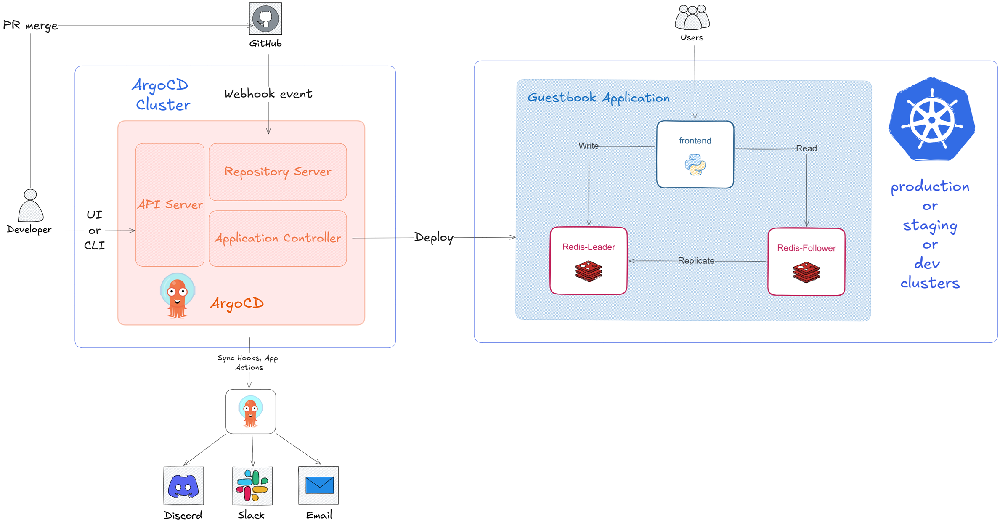
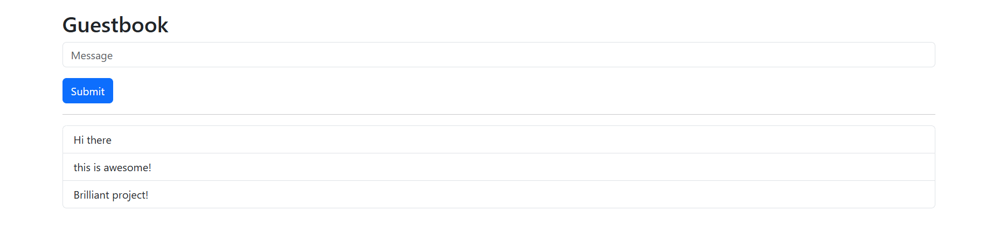

# Guestbook

**A multi-tier web application with Redis and Python (FastAPI) using Kubernetes.**

This application adapts the [Google](https://docs.cloud.google.com/kubernetes-engine/docs/tutorials/guestbook) and [Kubernetes](https://kubernetes.io/docs/tutorials/stateless-application/guestbook/) Guestbook samples, replacing the original PHP frontend with Python (FastAPI) and adjusting the deployment and service manifests for local Redis and frontend image development.

The frontend exposes `GET /health` for Kubernetes liveness and readiness probes.



## Installation

Run the commands from the repository root. You need a Kubernetes cluster and
`kubectl` configured to access it. To create a local development cluster with
kind, follow [the cluster setup guide](./docs/creating-cluster.md). The
examples below use the `dev` environment; replace `dev` with `staging` or
`prod` where appropriate.

### Build and load the frontend image (kind)

The manifests use `irajjelodari/guestbook:1.0.0`. Build it locally if you want
to use a local image, then load it and Redis into your kind cluster:

```sh
docker build --target runtime -t irajjelodari/guestbook:1.0.0 ./python-redis
kind load docker-image irajjelodari/guestbook:1.0.0 --name guestbook-cluster
kind load docker-image redis:8.8.2 --name guestbook-cluster
```

### Option 1: Kustomize manifests

Create the environment namespace, then apply the native Kubernetes manifests
with the selected overlay:

```sh
kubectl create namespace guestbook-dev
kubectl apply -k manifests/kustomize/overlays/dev
```

### Option 2: Helm chart

Install the chart directly. The chart defaults use the base replica counts:

```sh
helm install guestbook manifests/guestbookchart \
  --namespace guestbook \
  --create-namespace
```

To install an environment-specific configuration, select its values file and
namespace instead:

```sh
helm install guestbook manifests/guestbookchart \
  --namespace guestbook-dev \
  --create-namespace \
  --values manifests/guestbookchart/values-dev.yaml
```

Use `values-staging.yaml` or `values-prod.yaml` for the other environments.

### Option 3: Argo CD Application

First install Argo CD in the cluster using [the cluster setup guide](./docs/creating-cluster.md).
The Application manifests point to the Helm-rendered Kustomize overlays, so
enable Helm rendering in Argo CD before applying an Application:

```sh
kubectl apply -n argocd -f manifests/argocd/argocd-cm.yaml
kubectl rollout restart deployment/argocd-repo-server -n argocd
```

Apply the desired Application manifest:

```sh
kubectl apply -f manifests/argocd/guestbook-dev-application.yaml
```

The dev Application tracks the `development` branch; staging and prod track
`main`. Review the `targetRevision` in the selected Application manifest if
your branch names differ. Argo CD creates the target namespace and syncs the
application automatically.

### Alternative: Kustomize rendering the Helm chart

The `manifests/helm-kustomize` overlays combine the Helm chart with environment
configuration. To render or apply them with `kubectl`, see the
[Helm and Kustomize guide](./manifests/helm-kustomize/README.md).

### Access the application

Forward the frontend service in the namespace you installed to:

```sh
kubectl port-forward -n guestbook-dev service/frontend 8542:8000
```

For the default Helm installation, use `guestbook` as the namespace. Then open
http://localhost:8542.

### Clean up

Remove the selected deployment and namespace. For example, for the default
Helm installation:

```sh
helm uninstall guestbook -n guestbook
kubectl delete namespace guestbook
```

For native Kustomize:

```sh
kubectl delete -k manifests/kustomize/overlays/dev
kubectl delete namespace guestbook-dev
```

For Argo CD, delete the Application and its workload namespace:

```sh
kubectl delete -f manifests/argocd/guestbook-dev-application.yaml
kubectl delete namespace guestbook-dev
```

For an environment-specific Helm installation, use its release name and
namespace, for example `helm uninstall guestbook -n guestbook-dev`. To remove
the local cluster:

```sh
kind delete cluster --name guestbook-cluster
```



### Continuous integration

The GitHub Actions workflow runs on pushes and pull requests. It checks Python
syntax and API behavior with mocked Redis, builds the frontend Docker image
without publishing it, and lints and renders the Helm and Kustomize
configurations for dev, staging, and prod. It runs only the checks relevant to
changed paths: Python changes run Python checks and the image build, manifest
changes run manifest validation, and workflow changes run all checks. Manual
and release-triggered runs execute all checks.

### Releases

Publishing a GitHub release with a `vMAJOR.MINOR.PATCH` tag (optionally followed
by a prerelease suffix, such as `-rc.1`) runs the release workflow after all CI
checks pass. Configure the repository secrets `DOCKERHUB_USERNAME` and
`DOCKERHUB_TOKEN` with credentials that can push to
`irajjelodari/guestbook`.

### Clean-up

To remove the Helm release and clean up the namespace:

```sh
helm uninstall guestbook -n guestbook
kubectl delete namespace guestbook
kind delete cluster --name guestbook-cluster
```
